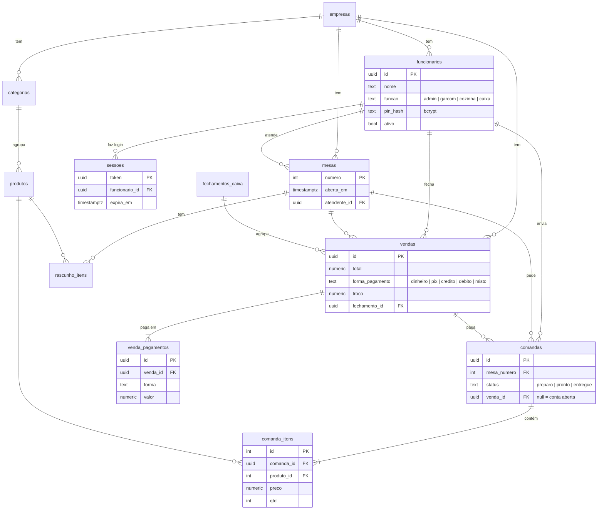

# Sistema Garçom 🍽

Sistema de restaurante **multiempresa**: vários restaurantes usam o mesmo sistema e cada um
vê só os próprios dados. Três ambientes: **Garçom**, **Cozinha** e **Caixa**, mais a área do administrador.
Feito com React 19 + Vite + Tailwind CSS 4 + Supabase (PostgreSQL).

🌐 **Acesse online:** https://sistema-garcom.vercel.app (Vercel) — também em
https://gabrielmachado1771.github.io/sistema-garcom/ (GitHub Pages). Veja [Hospedagem](#hospedagem).

## Como rodar

```bash
npm install
npm run dev      # abre em http://localhost:5173
npm run build    # gera a versão de produção em dist/
npm run lint
```

## Acesso e funções

Cada restaurante tem um **código** (ex.: `sobradinho`) e um link próprio:

- Vercel: `https://<seu-site>.vercel.app/r/<codigo>`
- GitHub Pages: `https://gabrielmachado1771.github.io/sistema-garcom/#/r/<codigo>`

Sem o link, a tela de login pede o código do restaurante (o aparelho lembra o último usado).
Depois, cada pessoa toca no seu nome e digita o seu **PIN de 4 números**.
O administrador encontra o link para mandar à equipe no **Painel → Restaurante → Copiar**.

| Função | Acessa |
|---|---|
| 🛡️ Administrador | Tudo: painel, garçom, cozinha, caixa, relatórios, cardápio e equipe |
| 📝 Garçom | Só mesas e pedidos |
| 👨‍🍳 Cozinha | Só a fila de pedidos |
| 💰 Caixa | Só contas, pagamentos e histórico |

**Primeiro acesso:** o administrador entra com o PIN provisório que recebeu, troca o PIN e cadastra
a equipe na aba **Equipe**. No Painel ele também define a taxa de serviço (0% a 30%) e o número de mesas.

O login vale por aba: dá para ter o garçom numa aba e a cozinha em outra, cada uma com seu usuário.

> No **modo local** (sem banco configurado) os PINs ficam no navegador, o que serve só para demonstração.
> Com o **banco de dados** ligado, o PIN é conferido no servidor e guardado com bcrypt.

## Portal do dono do sistema (`/#/admin`)

Área separada para quem administra o sistema inteiro (não é o admin de um restaurante):

- **Login por e-mail e senha** (Supabase Auth) com **verificação em 2 etapas obrigatória**
  (aplicativo autenticador: Google Authenticator, Microsoft Authenticator, Authy…)
- **Restaurantes:** status, vendas de hoje e do mês, mesas abertas agora e último acesso de cada um
- **Novo restaurante** em 4 passos: dados, primeiro administrador com PIN provisório, cardápio
  (vazio ou copiado de outro restaurante) e revisão — no fim, uma mensagem pronta para mandar ao cliente
- **Editar, suspender e reativar** restaurantes; **resetar o PIN** de qualquer funcionário
- **Acessar como suporte:** entra no restaurante por 2 horas com uma faixa amarela na tela;
  o acesso e tudo o que for feito ficam no log
- **Relatórios consolidados** de todos os restaurantes, por período, com planilha CSV
- **Auditoria:** logins, bloqueios, cancelamentos, mudanças de cardápio e de preço, equipe, caixa e
  ações do próprio portal — com filtro por restaurante, período e busca

Só entra quem está na tabela `super_admins`. O cadastro público do Supabase Auth deve ficar desligado.

## Funcionalidades

**Garçom**
- Mapa de mesas com status (livre, ocupada, em preparo, pronto para servir)
- Aviso "Prontos para servir" com botão *Servido*
- Cardápio com busca (ignora acentos) e filtro por categoria
- Pedido montado em rascunho e enviado à cozinha em rodadas (comandas) — dá para pedir mais itens depois
- Observação por item (ex.: 1 dos 3 hambúrgueres "sem cebola") e observação geral do pedido
- Cancelamento de pedido enquanto ainda está em preparo
- Trocar o cliente de mesa ou juntar duas mesas numa conta só
- **Variações e adicionais** (ex.: ponto da carne obrigatório, até 3 adicionais com preço) escolhidos ao lançar
- **Pedidos de balcão e retirada**, sem mesa, com nome do cliente e senha do dia (o caixa também lança)
- Produto **esgotado** aparece riscado e não pode ser lançado
- Cancelar um item ou pedido já enviado à cozinha exige **motivo e PIN de um administrador** (vai para a auditoria)
- Aviso com som, vibração e notificação do celular quando o pedido **dele** fica pronto

**Cozinha**
- Fila de pedidos do mais antigo para o mais novo, com tempo decorrido
- Destaque em vermelho para pedidos com mais de 20 minutos
- Observações de cada item em destaque
- Marcar como pronto / desfazer; aviso de pedido novo
- Variações e adicionais de cada item em destaque
- Painel **Esgotados** para marcar o que acabou

**Caixa**
- Contas abertas e valor total em aberto
- Taxa de serviço configurável por restaurante (pode ser removida na conta)
- **Desconto** em R$ ou %, com motivo e PIN de um administrador (fica na venda e na auditoria)
- Divisão da conta em partes iguais **ou por itens** (cada um paga o que consumiu; o que é "da mesa" é dividido entre todos)
- Pagamento em várias formas na mesma conta (ex.: R$ 20 dinheiro + R$ 5 débito + R$ 5 crédito), troco só do dinheiro
- Histórico do caixa aberto e fechamento de caixa (as vendas vão para os relatórios)

**Administrador**
- Painel com a visão geral e a **quantidade de mesas** do restaurante
- **Relatórios** por período: faturamento por dia/hora, formas de pagamento, produtos mais vendidos,
  vendas por garçom, caixas fechados e planilha CSV
- **Cardápio** editável: criar, editar preço, mover e remover produtos e categorias, marcar esgotado
  e configurar variações/adicionais de cada produto
- **Equipe**: cadastrar funcionários e definir a função de cada um

**Aplicativo no celular**
- Dá para instalar o site como app (botão **📲 Instalar**; no iPhone: Safari → Compartilhar → *Adicionar à Tela de Início*)

## Banco de dados (Supabase / PostgreSQL)

O sistema funciona em dois modos:

| Modo | Quando | Onde ficam os dados |
|---|---|---|
| ☁️ **Nuvem** | `VITE_SUPABASE_URL` e `VITE_SUPABASE_ANON_KEY` configuradas | PostgreSQL no Supabase — multiempresa, todos os aparelhos do restaurante veem os mesmos dados em tempo real |
| 💾 **Local** | sem configuração | `localStorage` do navegador — demonstração de um restaurante só |

### Modelo de dados



Todas as tabelas têm a coluna `empresa_id` (o restaurante). As chaves são por restaurante
(ex.: cada restaurante tem a sua "mesa 1") e as ligações entre tabelas incluem a empresa,
então o próprio banco impede que um pedido aponte para a mesa ou o produto de outro restaurante.

**Segurança:** todas as tabelas têm RLS ligado e nenhum acesso direto. O site só chama
**funções no banco** (`entrar`, `estado`, `adicionar_item`, `enviar_cozinha`, `finalizar_conta`, …).
Cada função confere o token da sessão e a função do funcionário, e **descobre o restaurante pela
sessão** — nenhuma função aceita o restaurante vindo do site. Um garçom não consegue fechar conta
nem cadastrar funcionário, e ninguém consegue ver ou alterar dados de outro restaurante, mesmo
chamando a API na mão. Restaurante suspenso tem as sessões bloqueadas na hora.

O tempo real usa um canal por restaurante, com nome secreto entregue só depois do login;
a mensagem não leva dados (só avisa "algo mudou").

**Testes** (podem ser rodados em qualquer banco; tudo é desfeito no final):
[`supabase/testes/operacao.sql`](supabase/testes/operacao.sql) testa a operação (esgotado, opções, balcão, desconto,
cancelamento e o bloqueio após 5 PINs de admin errados);
[`supabase/testes/portal-admin.sql`](supabase/testes/portal-admin.sql) testa o portal (permissões, 2FA obrigatório,
criar/suspender restaurante, reset de PIN, suporte e auditoria).

**Testes de isolamento:** [`supabase/testes/isolamento.sql`](supabase/testes/isolamento.sql) cria dois
restaurantes de teste e tenta, por todas as funções, fazer um enxergar ou alterar o outro.
Pode ser rodado em qualquer banco (tudo é desfeito no final); termina sem erro se estiver tudo isolado.

Tudo está em [`supabase/schema.sql`](supabase/schema.sql).

### Como configurar

1. Crie uma conta e um projeto grátis em [supabase.com](https://supabase.com).
2. No projeto, abra **SQL Editor → New query**, cole todo o conteúdo de `supabase/schema.sql` e clique em **Run**.
   ⚠️ Rodar de novo apaga e recria as tabelas.

**Já tinha o banco criado antes?** Não rode o `schema.sql` de novo. Rode só as migrações novas,
na ordem, pelo mesmo SQL Editor (elas não apagam dados):

- [`supabase/migracao-01-pagamento-dividido.sql`](supabase/migracao-01-pagamento-dividido.sql): pagamento dividido em várias formas.
- [`supabase/migracao-02-cardapio-mesas-relatorios.sql`](supabase/migracao-02-cardapio-mesas-relatorios.sql): observação por item, transferir mesas, quantidade de mesas, cardápio editável e relatórios.
- [`supabase/migracao-03-multiempresa.sql`](supabase/migracao-03-multiempresa.sql): multiempresa. Os dados existentes viram o primeiro restaurante. Faça um backup antes.
- [`supabase/migracao-04-portal-admin.sql`](supabase/migracao-04-portal-admin.sql): portal do dono do sistema e log de auditoria.
- [`supabase/migracao-05-operacao.sql`](supabase/migracao-05-operacao.sql): esgotado, variações/adicionais, balcão/retirada, desconto e cancelamento com PIN de admin.

3. Em **Project Settings → API** copie a **Project URL** e a chave **publishable** (ou *anon public*).
4. Para rodar no seu computador: copie `.env.example` para `.env.local`, preencha os dois valores e rode `npm run dev`.
5. Para o site publicado, configure as mesmas duas variáveis na hospedagem (veja abaixo).

A chave *publishable/anon* é feita para ficar no navegador; quem protege os dados são as regras do banco.
**Nunca** use a chave `service_role` no site.

## Hospedagem

**Vercel (principal):** importe o repositório do GitHub em [vercel.com](https://vercel.com) → *Add New → Project*.
O [`vercel.json`](vercel.json) já configura o build e as rotas (`/r/<codigo>` funciona direto).
Em *Settings → Environment Variables* crie `VITE_SUPABASE_URL` e `VITE_SUPABASE_ANON_KEY`.
Cada push na `main` publica sozinho.

**GitHub Pages (continua funcionando):** o workflow [`deploy.yml`](.github/workflows/deploy.yml) publica a cada push.
As variáveis ficam em **Settings → Secrets and variables → Actions → Variables** (`SUPABASE_URL` e `SUPABASE_ANON_KEY`).
No GitHub Pages o link do restaurante usa `#`: `.../sistema-garcom/#/r/<codigo>`.

## Detalhes técnicos

- Com banco: as telas se atualizam em tempo real (Supabase Realtime) e conferem o banco a cada 10 s; as ações aparecem na hora na tela e são confirmadas pelo banco em seguida.
- Sem banco: os dados ficam no `localStorage` e abas do mesmo navegador são sincronizadas.
- Navegação pela URL (`#/garcom/3`, `#/cozinha`, `#/caixa/historico`), então o botão voltar do navegador funciona.
- Link do restaurante: `#/r/<codigo>` (na Vercel também `/r/<codigo>`, convertido ao abrir).

## Estrutura

```
src/
  App.jsx                    rotas
  store/regras.js            regras de negócio (reducer e cálculos, sem React)
  store/RestauranteProvider  estado global (modo local ou nuvem)
  store/supabase.js          conexão com o banco e tradução das ações em funções SQL
supabase/schema.sql          tabelas, segurança e funções do banco (instalação do zero)
supabase/migracao-*.sql      atualizações para um banco que já existe
supabase/testes/             testes de isolamento entre restaurantes
  pages/                     Login, Painel, Equipe, Garcom, Mesa, Cozinha, Caixa, Conta, Historico
  components/ui.jsx          componentes visuais reutilizáveis
  data/cardapio.js           produtos e categorias
  utils/format.js            formatação de moeda e horários
```
