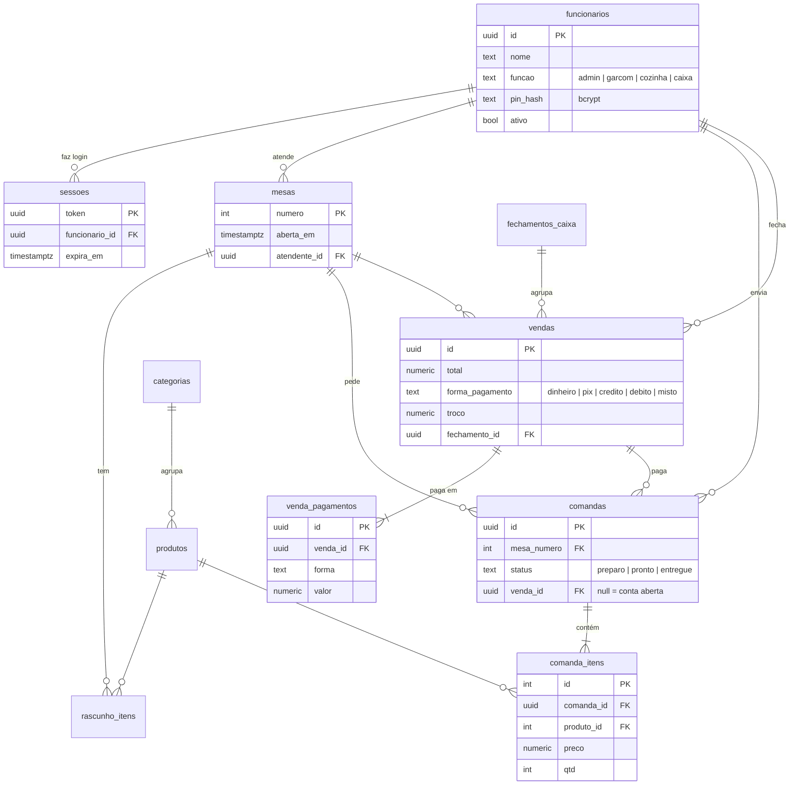

# Sistema Garçom 🍽

Sistema de restaurante com três ambientes: **Garçom**, **Cozinha** e **Caixa**.
Feito com React 19 + Vite + Tailwind CSS 4.

🌐 **Acesse online:** https://gabrielmachado1771.github.io/sistema-garcom/
(publicado automaticamente pelo GitHub Pages a cada push na `main`)

## Como rodar

```bash
npm install
npm run dev      # abre em http://localhost:5173
npm run build    # gera a versão de produção em dist/
npm run lint
```

## Acesso e funções

Cada pessoa entra escolhendo seu nome e digitando um **PIN de 4 números**.

| Função | Acessa |
|---|---|
| 🛡️ Administrador | Tudo: painel, garçom, cozinha, caixa, relatórios, cardápio e equipe |
| 📝 Garçom | Só mesas e pedidos |
| 👨‍🍳 Cozinha | Só a fila de pedidos |
| 💰 Caixa | Só contas, pagamentos e histórico |

**Primeiro acesso:** entre como *Administrador* com o PIN `1234`, troque o PIN e cadastre a equipe na aba **Equipe**.

O login vale por aba: dá para ter o garçom numa aba e a cozinha em outra, cada uma com seu usuário.

> No **modo local** (sem banco configurado) os PINs ficam no navegador, o que serve só para demonstração.
> Com o **banco de dados** ligado, o PIN é conferido no servidor e guardado com bcrypt.

## Funcionalidades

**Garçom**
- Mapa de mesas com status (livre, ocupada, em preparo, pronto para servir)
- Aviso "Prontos para servir" com botão *Servido*
- Cardápio com busca (ignora acentos) e filtro por categoria
- Pedido montado em rascunho e enviado à cozinha em rodadas (comandas) — dá para pedir mais itens depois
- Observação por item (ex.: 1 dos 3 hambúrgueres "sem cebola") e observação geral do pedido
- Cancelamento de pedido enquanto ainda está em preparo
- Trocar o cliente de mesa ou juntar duas mesas numa conta só
- Aviso com som, vibração e notificação do celular quando o pedido **dele** fica pronto

**Cozinha**
- Fila de pedidos do mais antigo para o mais novo, com tempo decorrido
- Destaque em vermelho para pedidos com mais de 20 minutos
- Observações de cada item em destaque
- Marcar como pronto / desfazer; aviso de pedido novo

**Caixa**
- Contas abertas e valor total em aberto
- Taxa de serviço de 10% (opcional)
- Divisão da conta em partes iguais **ou por itens** (cada um paga o que consumiu; o que é "da mesa" é dividido entre todos)
- Pagamento em várias formas na mesma conta (ex.: R$ 20 dinheiro + R$ 5 débito + R$ 5 crédito), troco só do dinheiro
- Histórico do caixa aberto e fechamento de caixa (as vendas vão para os relatórios)

**Administrador**
- Painel com a visão geral e a **quantidade de mesas** do restaurante
- **Relatórios** por período: faturamento por dia/hora, formas de pagamento, produtos mais vendidos,
  vendas por garçom, caixas fechados e planilha CSV
- **Cardápio** editável: criar, editar preço, mover e remover produtos e categorias
- **Equipe**: cadastrar funcionários e definir a função de cada um

**Aplicativo no celular**
- Dá para instalar o site como app (botão **📲 Instalar**; no iPhone: Safari → Compartilhar → *Adicionar à Tela de Início*)

## Banco de dados (Supabase / PostgreSQL)

O sistema funciona em dois modos:

| Modo | Quando | Onde ficam os dados |
|---|---|---|
| ☁️ **Nuvem** | `VITE_SUPABASE_URL` e `VITE_SUPABASE_ANON_KEY` configuradas | PostgreSQL no Supabase — todos os aparelhos veem os mesmos dados em tempo real |
| 💾 **Local** | sem configuração | `localStorage` do navegador |

### Modelo de dados



**Segurança:** todas as tabelas têm RLS ligado e nenhum acesso direto. O site só chama
**funções no banco** (`entrar`, `estado`, `adicionar_item`, `enviar_cozinha`, `finalizar_conta`, …),
e cada função confere o token da sessão e a função do funcionário — um garçom não consegue,
por exemplo, fechar conta nem cadastrar funcionário, mesmo chamando a API na mão.
Tudo está em [`supabase/schema.sql`](supabase/schema.sql).

### Como configurar

1. Crie uma conta e um projeto grátis em [supabase.com](https://supabase.com).
2. No projeto, abra **SQL Editor → New query**, cole todo o conteúdo de `supabase/schema.sql` e clique em **Run**.
   ⚠️ Rodar de novo apaga e recria as tabelas.

**Já tinha o banco criado antes?** Não rode o `schema.sql` de novo. Rode só as migrações novas,
na ordem, pelo mesmo SQL Editor (elas não apagam dados):

- [`supabase/migracao-01-pagamento-dividido.sql`](supabase/migracao-01-pagamento-dividido.sql): pagamento dividido em várias formas.
- [`supabase/migracao-02-cardapio-mesas-relatorios.sql`](supabase/migracao-02-cardapio-mesas-relatorios.sql): observação por item, transferir mesas, quantidade de mesas, cardápio editável e relatórios.

3. Em **Project Settings → API** copie a **Project URL** e a chave **publishable** (ou *anon public*).
4. Para rodar no seu computador: copie `.env.example` para `.env.local`, preencha os dois valores e rode `npm run dev`.
5. Para o site do GitHub Pages: no repositório, **Settings → Secrets and variables → Actions → Variables**,
   crie `SUPABASE_URL` e `SUPABASE_ANON_KEY` e rode o deploy de novo (ou faça um push).

A chave *publishable/anon* é feita para ficar no navegador; quem protege os dados são as regras do banco.

## Detalhes técnicos

- Com banco: as telas se atualizam em tempo real (Supabase Realtime) e conferem o banco a cada 10 s; as ações aparecem na hora na tela e são confirmadas pelo banco em seguida.
- Sem banco: os dados ficam no `localStorage` e abas do mesmo navegador são sincronizadas.
- Navegação pela URL (`#/garcom/3`, `#/cozinha`, `#/caixa/historico`), então o botão voltar do navegador funciona.

## Estrutura

```
src/
  App.jsx                    rotas
  store/regras.js            regras de negócio (reducer e cálculos, sem React)
  store/RestauranteProvider  estado global (modo local ou nuvem)
  store/supabase.js          conexão com o banco e tradução das ações em funções SQL
supabase/schema.sql          tabelas, segurança e funções do banco (instalação do zero)
supabase/migracao-*.sql      atualizações para um banco que já existe
  pages/                     Login, Painel, Equipe, Garcom, Mesa, Cozinha, Caixa, Conta, Historico
  components/ui.jsx          componentes visuais reutilizáveis
  data/cardapio.js           produtos e categorias
  utils/format.js            formatação de moeda e horários
```
